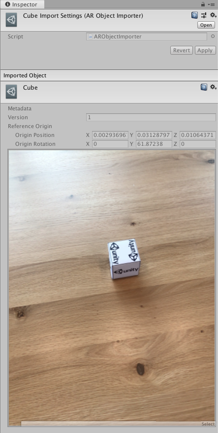
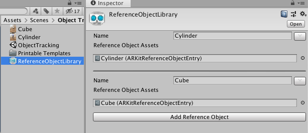

# Object tracking

This page is a supplement to the AR Foundation [Object tracking](xref:arfoundation-object-tracking) manual. The following sections only contain information about APIs where ARKit exhibits unique platform-specific behavior.

[!include]

## Configure reference object library

To use object tracking on ARKit, you first need to create a reference object library (refer to [Configure a reference object library](xref:arfoundation-object-tracking-reference-objects) for instructions).

### Scan your reference objects

Next, you need to create an ARKit-specific reference object entry. [Scanning and Detecting 3D Objects](https://developer.apple.com/documentation/arkit/scanning_and_detecting_3d_objects) (Apple Developer documentation) provides an app you can download that you can use to produce a scan of an object. This is a third-party application, and Unity is not involved in its development.

The scanning app produces a file with the extension `.arobject`. Drag each `.arobject` file into your Unity project, and Unity generates an `ARKitReferenceObjectEntry` for it.

 *Example scan in the Inspector.*

Once you have scanned an object, the **Inspector** displays metadata and a preview image of the scan.

### Add scanned objects to reference object library

You can now add the `.arobject` to a reference object in your reference object library as shown in the following image:

 *Example Reference Object Library*

[!include]
